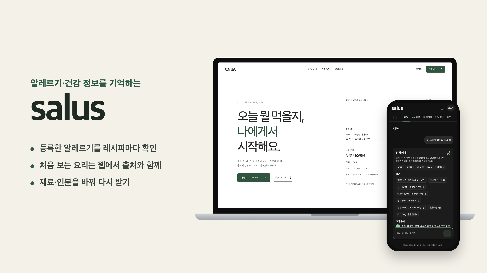

# Salus



알레르기·건강 정보를 한 번 등록해 두면, 레시피마다 먹어도 되는지 판단해 주는 로컬 LLM 식생활 서비스입니다. 채팅으로 요리를 물으면 미리 넣어 둔 기본 레시피나 웹에 실제로 있는 레시피를 출처와 함께 보여 주고, 등록한 알레르기 재료가 포함되어 있으면 위험을 알려 줍니다.

> 이 저장소는 포트폴리오 및 개발 검증 단계입니다. 의료 진단·처방을 제공하지 않으며, 생성 결과는 전문 의료인의 판단을 대체하지 않습니다.

화면과 만든 이유, 설계하며 내린 판단은 [노션 포트폴리오](https://charming-floss-d83.notion.site/2c2e4c08601480c096eeca4867278c68)에 정리했습니다. 이 문서는 코드 기준의 설계와 실행 방법을 다룹니다.

## 핵심 설계와 해결한 문제

### 1. 레시피를 생성하지 않고 추출한다

**문제.** 처음에는 검색 결과 요약문(최대 1,200자)을 LLM에 주고 레시피 전체를 쓰게 했습니다. 8B 모델은 비어 있는 재료와 분량을 그럴듯하게 채웠고, 평가 12개 중 7개만 통과했습니다.

**해결.** 레시피 페이지를 직접 열어 그대로 꺼내 오는 방식으로 바꿨습니다.

- 검색은 SearXNG를 기본으로 쓰고, 실패하면 DuckDuckGo로 넘어갑니다(`FallbackSearchEngine`). 검색이 실패한 경우와 정말 결과가 없는 경우를 구분해, 일시 장애가 7일짜리 "결과 없음" 캐시로 남지 않게 했습니다(`SearxngSearchEngine`).
- 페이지에 구조화 데이터(JSON-LD)가 있으면 코드로 먼저 읽고(`SchemaOrgRecipeJsonLdExtractor`), 없을 때만 `gemma3:4b`가 본문에서 재료와 단계를 추출합니다(`RecipeTextExtraction`).
- 요청한 요리 이름이 페이지 제목이나 본문에 없으면 받지 않습니다(`DISH_NOT_GROUNDED_IN_SOURCE`). 없는 요리를 비슷한 요리로 대신 채우는 일을 막기 위해서입니다.
- 웹 페이지 요청은 내부망 주소를 거부하고 리다이렉트마다 다시 검증합니다(`DefaultSafeWebPageFetcher`). 검색어에 건강 정보가 섞이면 외부로 보내지 않습니다(`ExternalSearchQueryPolicy`).
- 찾은 레시피는 `web_recipe_sources`에 "검토 전"으로 저장하고, 원문 대신 재료·요약 단계·출처 링크만 남깁니다.

**결과.** 처음 보는 유행 요리 14개 모두 출처를 찾았고, 본문 추출 시험에서 원문에 없는 재료는 0개였습니다.

### 2. 운영 판정 코드를 그대로 쓰는 평가 하네스

평가 도구가 채점 규칙을 따로 가지면 점수와 실제 서비스 동작이 갈라집니다. 그래서 하네스는 질문을 흘려보내고 점수만 모으고, 판정은 모두 운영 코드가 합니다([`docs/llm-eval-harness.md`](docs/llm-eval-harness.md)).

| 단계 | 사용하는 운영 코드 |
| --- | --- |
| 프롬프트 | `RecipePromptFactory` |
| 호출·파싱 | `OllamaRecipeGenerationClient`, `OllamaLlmService` |
| 레시피 규칙 | `RecipeDraftValidator` |
| 알레르기 | `AllergenMatcher` + `AllergenDictionary` |

- `live`는 실제 Ollama를 부르고, `replay`는 녹화한 응답을 HTTP 경계에서 넣어 결정적으로 다시 돌립니다(`./eval.sh --mode replay`).
- 모델을 비교할 때 바꾸는 건 모델 이름 하나뿐이고, 프롬프트·설정·검증 기준은 모두 같습니다.
- 알레르기 실패는 점수에 넣지 않고, 한 건이라도 있으면 무조건 실패입니다. 점수에 섞으면 총점이 높다는 이유로 안전 실패가 묻히기 때문입니다.

이 하네스로 로컬 모델 8개를 비교해 대화는 `qwen3:8b`, 추출·요약은 `gemma3:4b`로 나눴습니다(요약 응답 29.8초 → 15.9초). 서비스 흐름 전체는 실제 API로 질문을 보내는 실전 평가 43개(`scripts/e2e-eval.py`)로 확인하며, 통과 32 → 38개, 알레르기 위반 1 → 0건이 됐습니다.

### 3. 같은 코드인데 평가 결과가 매번 달랐던 이유

**문제.** 코드를 바꾸지 않았는데 평가 통과 수가 실행마다 7~9개로 달랐고, 우유 알레르기 감자스프 사례는 특정 실행에서만 우유가 남았습니다.

**원인.** Ollama는 JSON Schema의 `properties` 순서대로 필드를 생성합니다. 그런데 이 스키마를 `Map.of`로 만들고 있었고, `Map.of`의 순회 순서는 JVM이 시작할 때 정해지는 무작위 값(SALT)에 따라 바뀝니다. 같은 JVM 안에서는 순서가 일정하고 단위 테스트는 가짜 LLM 응답을 쓰기 때문에, 매번 새 JVM에서 실제 LLM을 부르는 평가에서만 드러났습니다. 감자스프는 `name → unit → amount` 순서일 때만 3번 중 3번 우유가 남았습니다.

**해결.** 스키마를 순서가 고정된 `LinkedHashMap`으로 만들고(`RecipePromptFactory.ordered`), 실제로 Ollama에 보내는 JSON 문자열의 순서까지 검사하는 테스트를 추가했습니다(`RecipePromptFactoryTest#schemaPropertyOrderIsFixedForEveryRequestKind`). 이후 3회 반복 결과가 같아졌습니다.

### 4. 알레르기 판정: 모르면 안전하다고 하지 않는다

- 식약처 알레르기 표시 대상을 기준으로 한 사전(`allergens/ko-allergens.yaml`)에 다른 이름과 파생 원료를 묶었습니다. 예를 들어 우유에는 버터·치즈·생크림·탈지분유 등이 들어갑니다. '코코넛밀크'처럼 잘못 걸리는 이름은 넣지 않고, '밀'처럼 한 글자 이름은 따로 떨어진 낱말일 때만 찾습니다.
- 레시피에 알레르기 재료가 있으면 포함 사실을 알리고, 뺄 수 있으면 빼고, 빼면 요리가 성립하지 않으면 추천하지 않습니다. 겹치는 재료를 찾지 못해도 "안전"이라고 하지 않고 원재료 표시 확인을 안내합니다.
- 등록한 알레르기는 대화 속 "빼고"보다 항상 우선합니다.

**해결한 문제 두 가지**

- 실전 평가에서 두쫀쿠의 '우유맛스틱'만 빼고 버터·탈지분유가 남은 레시피를 "우유 제외"로 안내했습니다. 제외 판단과 최종 검증이 '우유'라는 글자만 본 것이 원인이었고, 파생 원료까지 사전 기준으로 판정하도록 바꿨습니다(`AgentAllergyRemovalSafetyTest`).
- 등록 알레르기 '오이'의 끝 글자를 조사로 보고 잘라 '오'로 판정해 오이무침을 막지 못했습니다. 메시지에서 읽은 알레르기에만 조사를 떼도록 바꾸고, 포도·송이 등 같은 형태를 회귀 테스트로 추가했습니다(`ChatSafetyContextServiceTest`).

### 5. 계정과 결제

- **로그인:** Google·Kakao·Apple 토큰은 서버에서 직접 검증합니다. 같은 검증된 이메일의 계정이 있으면 기존 계정으로 다시 로그인한 뒤에만 연결하고, 동시 가입은 MySQL `GET_LOCK`으로 직렬화합니다.
- **Refresh 토큰:** 쓸 때마다 새 토큰으로 바꾸고, 이미 쓴 토큰이 다시 오면 탈취로 보고 그 회원의 토큰을 모두 폐기합니다. 앱이 같은 토큰으로 거의 동시에 두 번 갱신하는 정상 경합은 짧은 유예 시간으로 구분합니다(`RefreshTokenService`).
- **결제(포트원 V2):** 금액과 기간은 서버가 만든 주문으로 정하고, 결제 결과는 포트원에 다시 조회해 상태·금액·상점·통화를 대조합니다. 앱이 결제 직후 꺼져도 웹훅으로 같은 완료 처리를 타며, 주문 행을 잠가 한 번만 처리합니다. 웹훅은 서명과 5분 시간 범위를 확인한 뒤에도 본문 값을 믿지 않고 다시 조회합니다(`PaymentService`, `PaymentTxHelper`).

## 구조

```text
Salus/
├── backend/                 # Spring Boot API, 도메인, JPA Repository, Flyway
├── frontend/                # Expo/React Native 사용자 앱
├── admin/                   # Vite/React 관리자 웹
├── docs/                    # 설계 문서, 평가 하네스, AI 작업 지침
├── scripts/                 # 실전 평가, 베타 서버 운영 스크립트
├── .github/                 # CI, Dependabot, Issue/PR 템플릿
├── docker-compose.yml       # 로컬 Redis
└── docker-compose.prod.yml  # MySQL, Redis, SearXNG, backend, admin
```

## 기술 스택

| 영역 | 기술 |
| --- | --- |
| Backend | Java 17, Spring Boot 3.2.1, Spring MVC, WebFlux `WebClient`, Spring Security, JWT |
| Data | Spring Data JPA, Hibernate, MySQL 8.0, Flyway, Redis `StringRedisTemplate` |
| AI/Search | Ollama(`qwen3:8b`, `gemma3:4b`), SearXNG, DuckDuckGo 대체 검색, 선택적 Tavily·MFDS·RxNorm·openFDA adapter |
| Payment | PortOne V2 |
| User app | Expo 54, React Native 0.81, React 19 |
| Admin | React 19, Vite 6, React Router 7 |
| Quality/Operations | JUnit 5, Mockito, Maven, npm, GitHub Actions, Dependabot, Docker Compose |

영속성 계층은 Spring Data JPA·Hibernate만 사용합니다. MyBatis는 쓰지 않습니다.

## 승인 레시피 카탈로그

기본 레시피의 원본은 `backend/src/main/resources/recipes/approved-recipes.json`입니다. 현재 10개를 승인하며, 애플리케이션 시작 시 엄격하게 검증한 뒤 DB와 동기화합니다. 검증에 실패하면 서버가 시작되지 않습니다.

- 공개 목록과 내부 DB 근거 검색은 `approval_status=APPROVED`인 행만 사용합니다. 파일에 없는 승인 행은 `UNVERIFIED`로 되돌립니다.
- 웹 검색 결과는 승인 카탈로그로 자동 승격하지 않습니다.
- 승인 문서에는 기준 인분, 재료별 계량값, 불 세기, 시간, 완료 상태, 버전, SHA-256 해시와 서로 다른 도메인의 출처 2개를 기록합니다.
- 인분 변경은 1~6인분 범위에서 승인 원본을 매번 다시 계산합니다.
- 식품 안전 온도·유지 시간은 사용자 문구와 분리된 구조화 필드로 검증합니다.

레시피를 늘릴 때는 두 출처 대조와 실제 조리 검증을 마친 뒤 카탈로그 버전을 올리고 `ApprovedRecipeServiceTest`와 전체 백엔드 테스트를 통과시켜야 합니다.

## 현재 한계

- 처음 보는 요리는 16GB 노트북의 로컬 LLM으로 처리해 답까지 30초 정도 걸립니다. 한 번 찾은 레시피는 저장해 다시 씁니다.
- 회원이 몇 시간 뒤 같은 채팅방에서 이어서 물으면 작업 세션(Redis TTL 6시간)이 만료돼 앞의 레시피를 찾지 못합니다.
- 게스트의 하루 새 요리 검색 횟수는 IP로 세서, 같은 네트워크의 사용자끼리 횟수를 나눠 씁니다.
- 복용약과 음식 궁합 확인은 대표 사례도 잡지 못해 꺼 두었습니다.
- 알레르기 사전은 모든 식품명 동의어와 교차오염을 다루지 못합니다.

비밀정보와 민감 데이터 처리 원칙은 [SECURITY.md](SECURITY.md)를 참고하세요.
